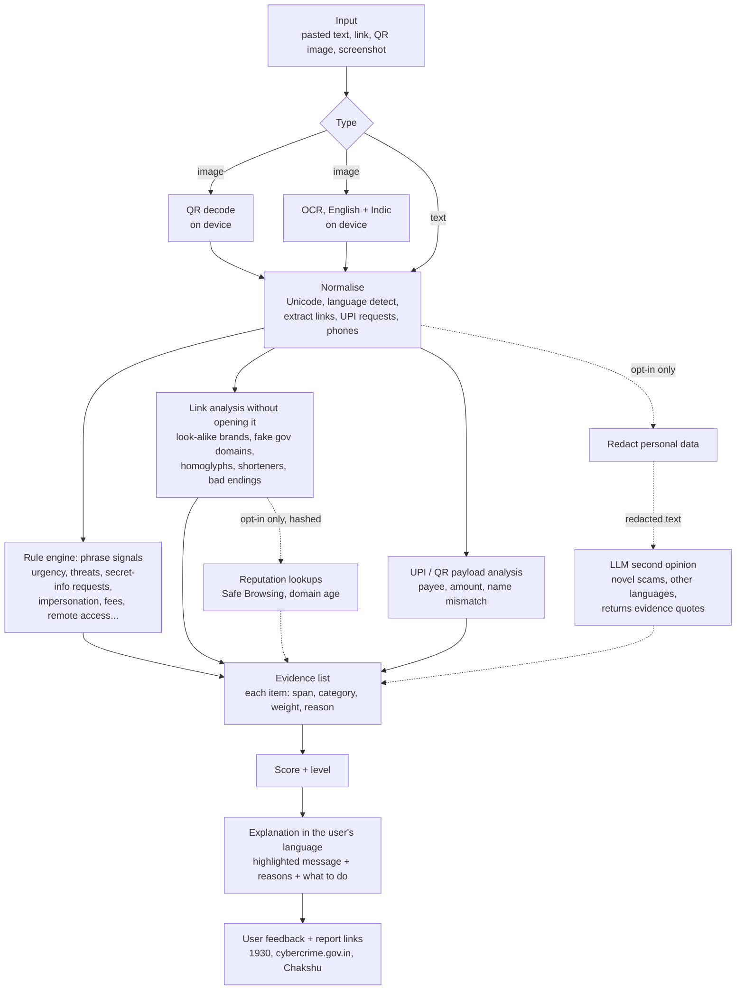

# Build pipelines

How to take each prototype from "rule-based demo" to the full solution the problem statement asks for.
Each section gives the architecture, the stages in order, what the prototype already covers, the stack, how to evaluate it, and a build plan.

---

## Problem 1: AI Agent for Everyday Government Services (Seva Saathi)

**Ask:** understand a person's need, find official information, produce a personalised document checklist, explain next steps in their language.
**Innovation criteria:** ground every answer in official sources, show citations, flag uncertain or outdated information.

### Architecture

```mermaid
flowchart TD
  subgraph Offline["Offline: ingestion (nightly)"]
    A[Official sources<br/>myscheme.gov.in, india.gov.in,<br/>ministry and state portals, PDFs] --> B[Fetch + snapshot<br/>store URL, date, content hash]
    B --> C[Parse and chunk<br/>by heading: eligibility, documents, process]
    C --> D[LLM extraction to a fixed schema<br/>rules, documents, steps, each with the quoted source passage]
    D --> E{Validation<br/>schema check, quote found in page,<br/>human review of changes}
    E --> F[(Scheme store<br/>structured records)]
    C --> G[(Vector + keyword index<br/>multilingual embeddings)]
  end
  subgraph Online["Online: one conversation turn"]
    U[User message<br/>text or voice, any language] --> L[Language detect + normalise]
    L --> I[Intent and profile extraction<br/>need, age, state, occupation...]
    I --> R[Hybrid retrieval + rerank<br/>filter by state and category]
    R --> Q{Enough profile to<br/>apply the rules?}
    Q -- no --> ASK[Ask the next most useful question]
    Q -- yes --> RULES[Rule engine<br/>deterministic eligibility + checklist]
    RULES --> GEN[LLM writes the answer in the user's language<br/>from retrieved records only, citing each claim]
    GEN --> V{Verifier<br/>every claim has a citation that supports it,<br/>numbers match the record}
    V -- fail --> FALL[Drop the claim or say "I could not confirm this"]
    V -- pass --> OUT[Answer + checklist + next steps<br/>+ citations + freshness flags]
  end
  F --> RULES
  G --> R
```

### Stages

| # | Stage | What happens | In the prototype | To build |
|---|-------|--------------|------------------|----------|
| 1 | **Source registry** | A list of allowed official domains (`*.gov.in`, `*.nic.in`, named portals). Nothing else is ever ingested. | Source URLs per entry, test enforces official domains | Registry file with crawl rules per site |
| 2 | **Fetch and snapshot** | Download pages/PDFs on a schedule. Store raw content, URL, fetch date and hash. A changed hash triggers re-extraction. | `snapshot` date on each entry (hand-set) | Scheduled crawler (Playwright for JS pages, `pdfplumber` for PDFs) |
| 3 | **Parse and chunk** | Split by section heading so that "Eligibility", "Documents required" and "How to apply" stay intact. Keep the heading path and URL with every chunk. | n/a | HTML to Markdown, heading-aware chunker |
| 4 | **Structured extraction** | An LLM fills a fixed schema: benefit, eligibility rules as conditions, documents with the condition under which each is needed, steps, fees, deadlines. Every field carries the **quoted passage** it came from. | The schema itself: `kb.js` (`rules`, `docs` with `if`, `steps`, `caveats`, `sources`) | Extraction prompt with structured output; reject fields whose quote is not found verbatim in the page |
| 5 | **Review gate** | New or changed records go to a human queue showing the diff and the quoted passages. Volatile fields (fees, rates, dates) are tagged so the answer always carries a "check current value" note. | `caveats` on each entry | Small review UI or a pull-request workflow on the records |
| 6 | **Index** | Embed chunks with a multilingual model and also build a keyword index. Indian-language queries and scheme acronyms need both. | Keyword search over English, Hindi and Hinglish terms (`search()`) | Vector store + BM25, reciprocal-rank fusion, reranker |
| 7 | **Understand the user** | Detect language, transliterate Hinglish, pull out the need and any profile facts already stated ("I am a 19-year-old student in Kerala"). | Language toggle, free-text need | LLM call with structured output: `{need, state, age, occupation, ...}` |
| 8 | **Retrieve** | Hybrid search filtered by state and category, top results reranked. If the best score is below a threshold, **stop and say so**. | Implemented, including the refusal path | Threshold tuned on the evaluation set |
| 9 | **Clarify** | Ask only for the facts that the candidate schemes' rules need, most decisive first. Reuse earlier answers. | Implemented (`ask` lists, shared profile) | Pick the question that splits the most candidate schemes |
| 10 | **Decide with rules, not with the model** | Eligibility and the checklist are computed by code from the structured record. The model never decides who qualifies. Three outcomes: eligible, not eligible, needs confirmation. | Implemented (`evaluate()`) | Same engine, records now come from stage 4 |
| 11 | **Write the answer** | The LLM turns the rule results and retrieved passages into a plain-language answer in the user's language. It may use only the supplied records, must attach a citation ID to every sentence, and must say "not found in official sources" for anything missing. | Bilingual templates | Generation prompt + per-language glossary for scheme names |
| 12 | **Verify** | A second pass checks that each cited passage supports its sentence and that every number in the answer appears in the source record. Unsupported sentences are removed or replaced with a caveat. | n/a | Entailment check (LLM or NLI model) + exact number matching |
| 13 | **Freshness and uncertainty flags** | Show the retrieval date. Flag records older than the threshold, records whose source hash changed since extraction, conflicting sources, and volatile fields. | Stale flag (6 months), caveats, "prototype data" notice | Driven by snapshot metadata from stage 2 |
| 14 | **Deliver** | Checklist with tick boxes, copy/print/WhatsApp share, links to the official application page. Optional voice in and out for low-literacy users. | Checklist, copy, links | Speech-to-text and text-to-speech (Bhashini or browser speech APIs) |

### Recommended stack

| Layer | Hackathon choice | Notes |
|-------|------------------|-------|
| Frontend | The existing static page | Add voice input with the Web Speech API |
| Backend | FastAPI (Python) | Three endpoints: `/chat`, `/scheme/{id}`, `/ingest` |
| LLM | Claude (Sonnet for answers, Haiku for extraction and verification) | Use structured outputs for stages 4 and 7; keep the API key on the server |
| Embeddings | `intfloat/multilingual-e5-base` or `BAAI/bge-m3` | Both handle Hindi and code-mixed queries |
| Stores | SQLite for records, Chroma or FAISS for vectors | Postgres + pgvector later |
| Translation / speech | Bhashini APIs, or the LLM directly | Keep scheme names in both scripts |
| Ingestion | Playwright + `trafilatura` + `pdfplumber` | Respect robots.txt; cache snapshots |

### Evaluation

- **Retrieval:** 50 to 100 real questions in English, Hindi and Hinglish, each labelled with the right scheme. Report recall@3.
- **Eligibility:** table of profiles and expected verdicts per scheme (the prototype's test file is the starting point). Target 100%, since it is code.
- **Grounding:** share of answer sentences with a supporting citation; number of unsupported numeric claims (target zero).
- **Refusal:** out-of-scope questions must get "not found", never an invented scheme.
- **Freshness:** change a source page in a test fixture and confirm the answer gets flagged.

### Build plan (24 to 36 hours, team of 3 or 4)

1. **Hours 0 to 3:** pick 15 to 20 schemes for one state. Review the 12 seed entries against the official sites and fix anything stale.
2. **Hours 3 to 10:** ingestion for those pages, extraction to the existing schema, review by a teammate.
3. **Hours 6 to 14 (parallel):** backend `/chat` with retrieval, profile extraction and the existing rule engine.
4. **Hours 14 to 22:** answer generation with citations, then the verifier.
5. **Hours 22 to 28:** freshness flags from real snapshot dates, voice input, a third language.
6. **Rest:** evaluation numbers on a slide, demo rehearsal.

### Demo script (3 minutes)

1. Type "mujhe gas connection chahiye" and show retrieval working on Hinglish.
2. Answer the questions; show the verdict with a reason per rule and the citations.
3. Switch to Hindi mid-conversation.
4. Ask for a passport for a 10-year-old, then for an adult: the checklist changes.
5. Ask something out of scope: it refuses instead of inventing.
6. Point at the "last reviewed" and "check before you act" notes.

---

## Problem 6: Multilingual Scam & QR-Code Defence (ScamShield)

**Ask:** privacy-aware assistant that analyses suspicious messages, URLs, QR codes and screenshots in English and at least one Indian language, identifies phishing indicators, and explains the evidence behind its risk assessment before the user clicks or pays.

### Architecture



Solid lines run entirely on the device. Dotted lines are optional, off by default, and receive only redacted or hashed data.

### Stages

| # | Stage | What happens | In the prototype | To build |
|---|-------|--------------|------------------|----------|
| 1 | **Input** | Paste text, drop/paste/upload an image, later share-sheet and live camera. | Text, upload, drag-drop, clipboard paste | PWA share target, camera scanning |
| 2 | **QR decode** | Decode locally. Classify the payload: UPI request, web link, SMS/call trigger, Wi-Fi, plain text. | jsQR bundled, payload classified | Camera stream, multi-QR images |
| 3 | **OCR** | Read text from screenshots on the device, English + Hindi (+ other scripts). | Tesseract.js loaded on demand (untested in the sandbox) | Bundle the language data for offline use; try on-device ML Kit in a mobile build |
| 4 | **Normalise** | Unicode normalisation, zero-width character removal, language and script detection, Hinglish detection. Extract links, UPI strings, phone numbers. | Implemented (`detectLang`, link and UPI extraction) | Zero-width and bidi-control stripping |
| 5 | **Phrase signals** | Category rules per language. Negation handling so "do not share your OTP" is not flagged as a request. | 20 categories across English, Hindi, Hinglish (`RULES`) | More languages; phrase lists maintained from reported scams |
| 6 | **Link analysis** | Never open the link. Compute the real registered domain and compare with an allowlist of official domains; detect brand tokens, misspellings (edit distance after digit/letter substitution), fake government names, look-alike alphabets, `@`, raw IPs, shorteners, `.apk`. | Implemented (`analyzeUrl`) | Full Public Suffix List; larger brand list; optional reputation lookup |
| 7 | **UPI / payment analysis** | Parse `upi://pay` fields. Explain that a payment request can only send money. Flag bait names ("refund", "cashback"), brand name on a personal handle, pre-filled amounts. | Implemented (`analyzeUpi`) | Merchant-code checks, collect-request screenshots |
| 8 | **Scoring** | Each category contributes its strongest hit; categories combine so that several independent signals raise the score. Weak signals (a bank's name, "Dear customer") count only alongside a strong one. | Implemented, calibrated by tests | Fit weights on labelled data (logistic regression keeps it explainable) |
| 9 | **Explain** | Highlight the exact words, group reasons by category, state why each matters, give next steps. Never output "safe": the lowest level is "no strong scam signals found". | Implemented in English and Hindi | More languages; read-aloud |
| 10 | **Privacy layer** | Default: nothing leaves the device. Before any optional cloud call, mask phone, Aadhaar, card, account, PAN, e-mail and codes, and show the user the redacted text. No storage of inputs. | Redaction + preview implemented; no network calls exist | Consent toggle; on-device small model as the private alternative |
| 11 | **LLM second opinion (opt-in)** | Send the redacted text. Ask for a verdict plus **quoted evidence spans** and the scam type. Accept only evidence that can be located in the original text, then merge it into the evidence list. Covers new scam scripts and languages the rules do not know. | n/a | Claude Haiku with structured output; evidence-span validation |
| 12 | **Reputation (opt-in)** | Check the domain against Google Safe Browsing (hash-prefix API, so the full URL is not revealed), PhishTank/OpenPhish feeds, and domain age via RDAP. | n/a | Server proxy with caching |
| 13 | **Feedback and reporting** | "Was this right?" stored without the message text; one-tap links to 1930, cybercrime.gov.in and Chakshu (Sanchar Saathi). | Advice with reporting channels | Feedback counter per rule to find weak rules |

### Recommended stack

| Layer | Hackathon choice | Notes |
|-------|------------------|-------|
| App | The existing static page, made installable as a PWA | Works offline; share-target lets users forward from WhatsApp |
| QR | jsQR (bundled) or the browser `BarcodeDetector` | Already wired in |
| OCR | Tesseract.js with `eng` + `hin` data bundled | Add `tam`, `tel`, `ben`, `mal` as needed |
| Rules | `engine.js` | Pure functions, runs in browser and Node, covered by tests |
| Optional ML | Fine-tuned multilingual classifier (IndicBERT / MuRIL / XLM-R), exported to ONNX and run with `onnxruntime-web` | On-device, so privacy holds |
| Optional LLM | Claude via a small server proxy (FastAPI) | Redacted input only; key stays server-side |
| Reputation | Safe Browsing Update API, RDAP | Behind the same proxy |

### Evaluation

- **Dataset:** 300+ messages, balanced scam/genuine, across English, Hindi and Hinglish. Sources: public SMS spam sets, Sanchar Saathi and bank awareness examples, the team's own inboxes (genuine OTP, delivery and bank alerts are the important negatives).
- **Metrics:** precision and recall at the "likely a scam" threshold, reported per language. **False positives on genuine bank/OTP messages** reported separately.
- **Explanation quality:** for each flagged message, does at least one highlighted span match a human-marked reason?
- **QR set:** 30 codes covering UPI (shop, personal, bait name), phishing links, official links, SMS/call triggers.
- **Privacy check:** run with the network tab open and show zero requests during analysis.
- The prototype's test file (`tests/scamshield.test.js`) is the regression suite; add every miss to it.

### Build plan (24 to 36 hours, team of 3 or 4)

1. **Hours 0 to 4:** collect and label the dataset; run the current engine and record the baseline.
2. **Hours 4 to 10:** fix misses by adding rules; add a third language (the team's strongest).
3. **Hours 6 to 14 (parallel):** bundle OCR language data, add camera scanning, make it a PWA with share-target.
4. **Hours 14 to 22:** opt-in LLM second opinion with redaction and evidence validation.
5. **Hours 22 to 28:** reputation lookup, feedback buttons, metrics slide.
6. **Rest:** demo rehearsal with real forwarded messages.

### Demo script (3 minutes)

1. Paste the bank KYC message: score, highlighted words, grouped reasons.
2. Switch the explanation to Hindi; run the Hindi electricity message and the Hinglish OTP one.
3. Run the genuine OTP alert: low score, and the "do not share" line is recognised as protective.
4. Scan the "Refund" QR: it is a payment request to a personal ID with a pre-filled amount. Then the shop QR: caution only.
5. Open the privacy view and the browser network tab: nothing was sent.
